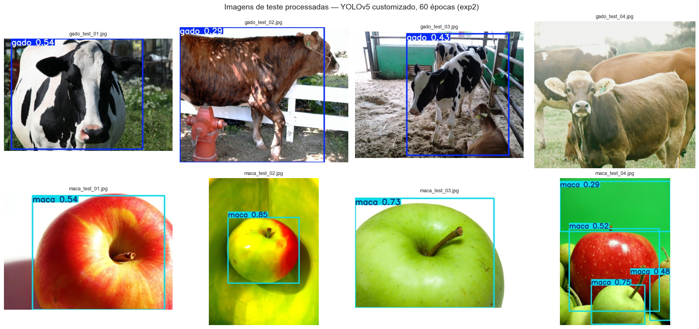
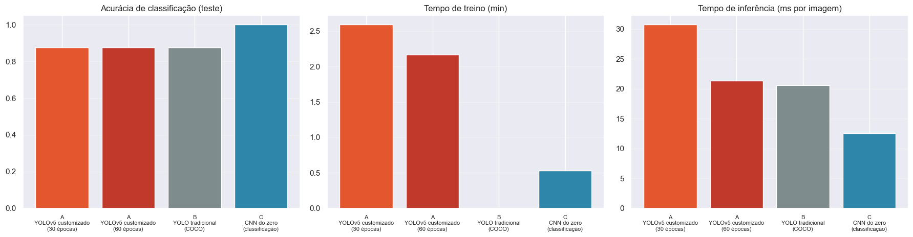
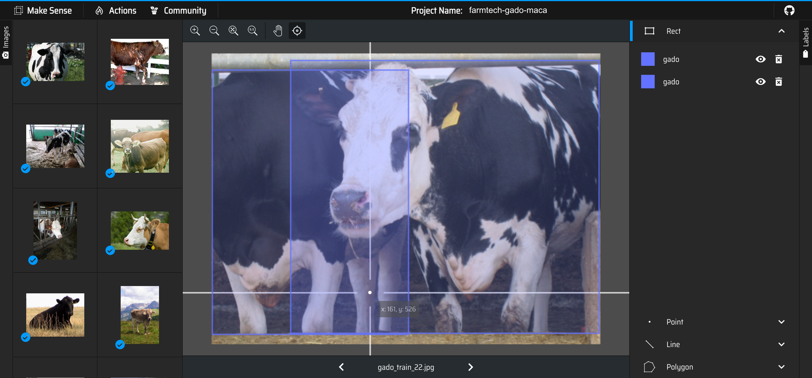

# FIAP - Faculdade de Informática e Administração Paulista

<p align="center">
<a href= "https://www.fiap.com.br/"></a>
</p>

<br>

# FarmTech Solutions — Visão Computacional com YOLO

## Grupo 51 · Fase 6 · Cap 1 — O despertar da Rede Neural

## 👨‍🎓 Integrantes:
- Douglas Felicio da Silva — RM572312
- Gabriel Kaique Portel Silva — RM572500
- Richard Wrobel dos Santos — RM573998

## 👩‍🏫 Professores:
### Tutor(a)
- Nicolly Candida Rodrigues de Souza
### Coordenador(a)
- André Godoi Chiovato

---

## 📜 Descrição

A FarmTech Solutions passou a atender saúde animal e segurança de propriedades
rurais, e um cliente quer ver na prática como funciona um sistema de visão
computacional. Construímos um detector **YOLOv5** que reconhece dois objetos bem
diferentes, ambos ligados ao campo — **gado bovino** e **maçã** — e o comparamos
com duas alternativas: a **YOLO tradicional** (pesos do COCO, sem treino) e uma
**CNN treinada do zero**.

| | Entrega | O que foi feito |
|---|---|---|
| **1** | YOLO customizado | base de 80 imagens (40 + 40), rotulada no Make Sense, organizada no Google Drive; treino no Colab com **30** e **60** épocas; validação, teste e prints |
| **2** | Comparação | YOLO customizado × YOLO tradicional × CNN do zero, nos quatro critérios do enunciado |

### ▶️ O relatório completo está no notebook

| | Link |
|---|---|
| **Notebook (GitHub)** | [`notebook/DouglasFelicioDaSilva_rm572312_pbl_fase6.ipynb`](notebook/DouglasFelicioDaSilva_rm572312_pbl_fase6.ipynb) |
| **Abrir no Colab** | [](https://colab.research.google.com/github/DougFel/fiap-fase6-grupo51-farmtech-yolo/blob/main/notebook/DouglasFelicioDaSilva_rm572312_pbl_fase6.ipynb) |
| **Vídeo de demonstração** (YouTube, não listado, 4min46s) | [https://youtu.be/-FiXO2K4xeA](https://youtu.be/-FiXO2K4xeA) |

O notebook traz o passo a passo das três etapas (treino, validação e teste), os
gráficos, as tabelas e a análise crítica. Este README só apresenta o projeto e
aponta o caminho.

### Resultados em uma página

**Entrega 1 — YOLOv5 customizado** (Colab, GPU Tesla T4). Com 60 épocas o
modelo foi melhor em todas as medidas de teste; a perda de validação ainda caía
aos 60, sem sinal de overfitting.

| Teste (8 imagens) | 30 épocas | 60 épocas |
|---|---|---|
| mAP@0.5 | 0,739 | **0,811** |
| mAP@0.5:0.95 | 0,439 | **0,569** |
| Precisão / Recall | 0,611 / 0,827 | **0,789** / 0,750 |
| Tempo de treino | 2,6 min | 2,2 min |

<p align="center"></p>

*Imagens de teste processadas pelo modelo de 60 épocas (`runs/detect/exp2`). Ele
acerta as fotos com um animal e todas as maçãs; o ponto fraco é o rebanho
(`gado_test_04`), pouco representado na base.*

**Entrega 2 — comparação nas mesmas 8 imagens de teste**

| Abordagem | mAP@0.5 | Acurácia (imagem) | Treino | Inferência |
|---|---|---|---|---|
| A · YOLOv5 customizado (60 épocas) | **0,798** | 87,5% | ~2 min | ~21 ms |
| B · YOLO tradicional (COCO) | 0,665 | 87,5% | nenhum | ~21 ms |
| C · CNN treinada do zero | — (não localiza) | **100%** | ~30 s | ~13 ms |

O ajuste fino com 64 fotos rendeu **13 pontos de mAP** sobre o modelo pronto; a
CNN acerta todas as classificações, mas não diz onde está o objeto. A análise
completa — e por que o COCO ainda é melhor em rebanho — está no notebook.

<p align="center"></p>

### 🏷️ Rotulagem no Make Sense

<p align="center"></p>

*As 80 imagens foram rotuladas no [Make Sense](https://www.makesense.ai) (101
caixas, classes `gado` e `maca`) e exportadas em formato YOLO; o pacote original
está em [`dataset/makesense/`](dataset/makesense/).*

---

## 📁 Estrutura de pastas

```
.
├── README.md
├── notebook/
│   ├── DouglasFelicioDaSilva_rm572312_pbl_fase6.ipynb   relatório completo (executado no Colab)
│   ├── gerar_notebook.py                                fonte do notebook (texto e código versionados)
│   └── textos_analise.py                                conclusões e análise crítica do notebook
├── dataset/
│   ├── images/{train,val,test}/     80 imagens: 32/4/4 de cada classe
│   ├── labels/{train,val,test}/     rótulos YOLO desenhados no Make Sense
│   ├── makesense/                   pacote exportado do Make Sense + lista de rótulos
│   └── fontes.csv                   autoria e licença (CC BY 2.0) de cada imagem
├── scripts/
│   ├── montar_dataset.py            reconstrói a base a partir do Open Images V7
│   └── selecao_curada.csv           as 80 imagens escolhidas na curadoria visual
├── assets/                          logo e figuras deste README (prints do teste, Make Sense)
└── video/                           roteiro, narração e montagem do vídeo
```

## 🔧 Como executar o código

**No Google Colab (recomendado).**

1. Clique em **Abrir no Colab** (tabela acima).
2. `Ambiente de execução → Alterar o tipo de ambiente de execução → GPU T4`.
3. `Ambiente de execução → Executar tudo` e autorize o acesso ao Google Drive.

Na primeira execução o notebook copia a base (imagens e rótulos) para
`MyDrive/FarmTech_Fase6/dataset/` e grava tudo o que produz em
`MyDrive/FarmTech_Fase6/resultados/`. Com GPU T4 leva cerca de 15 minutos.

**Versões.** Python 3, PyTorch e TensorFlow da imagem padrão do Colab; YOLOv5
fixado no commit `f957879` da Ultralytics (o notebook faz o checkout).

**Reconstruir a base (opcional).** `python scripts/montar_dataset.py` baixa as
mesmas 80 imagens do Open Images V7 a partir de `scripts/selecao_curada.csv`.

## 🗃 Histórico de lançamentos

* 1.0.0 - 13/10/2026
    * Entregas 1 e 2: notebook executado no Colab, README e vídeo
* 0.1.0 - 12/10/2026
    * Base de imagens curada, rotulada no Make Sense e organizada para o YOLO

## 📋 Licença

<p xmlns:cc="http://creativecommons.org/ns#" xmlns:dct="http://purl.org/dc/terms/"><a property="dct:title" rel="cc:attributionURL" href="https://github.com/agodoi/template">MODELO GIT FIAP</a> por <a rel="cc:attributionURL dct:creator" property="cc:attributionName" href="https://fiap.com.br">Fiap</a> está licenciado sobre <a href="http://creativecommons.org/licenses/by/4.0/?ref=chooser-v1" target="_blank" rel="license noopener noreferrer" style="display:inline-block;">Attribution 4.0 International</a>.</p>

As imagens da base são do Open Images V7, licença CC BY 2.0; a autoria de cada
uma está em `dataset/fontes.csv`.
